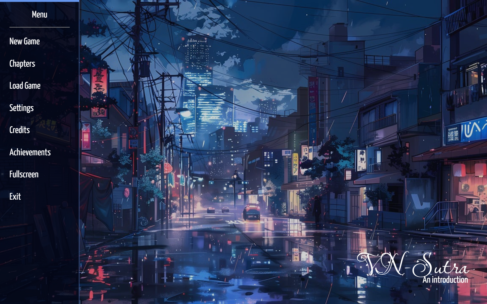
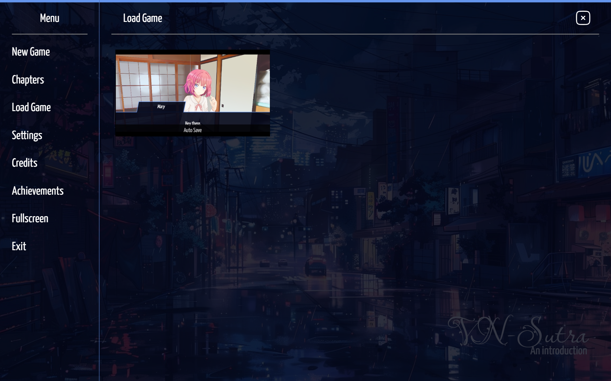
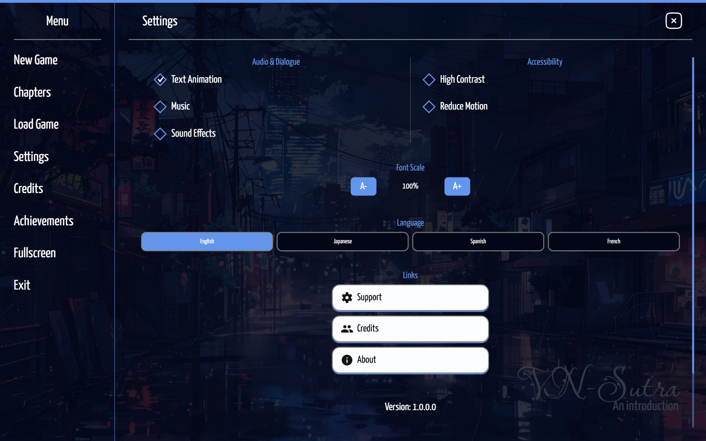
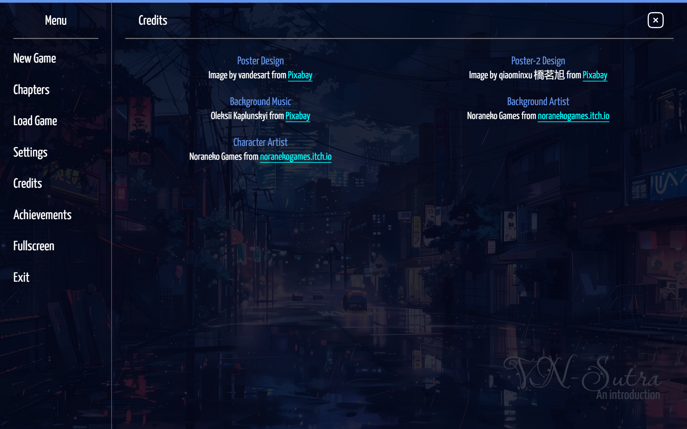
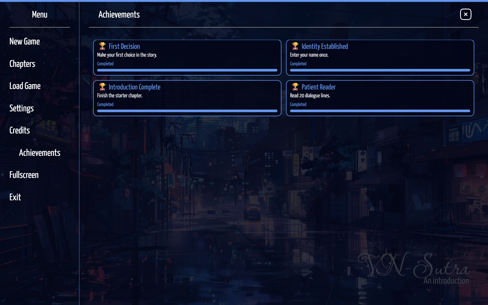
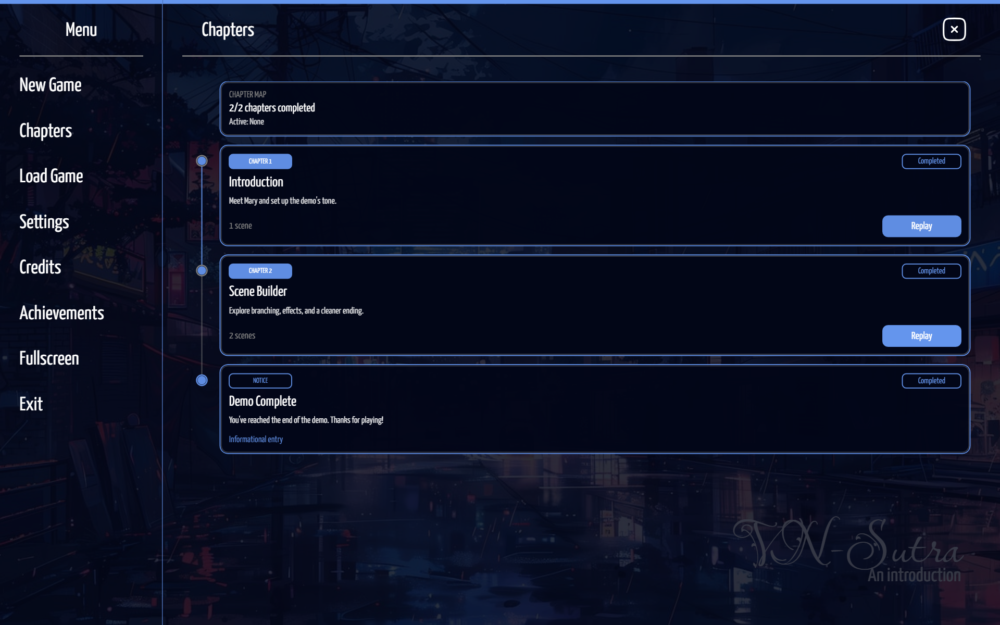
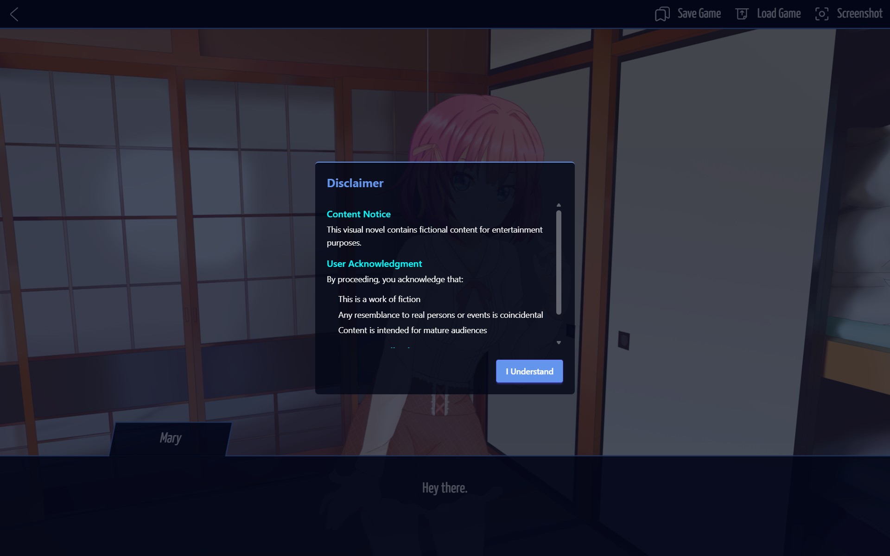
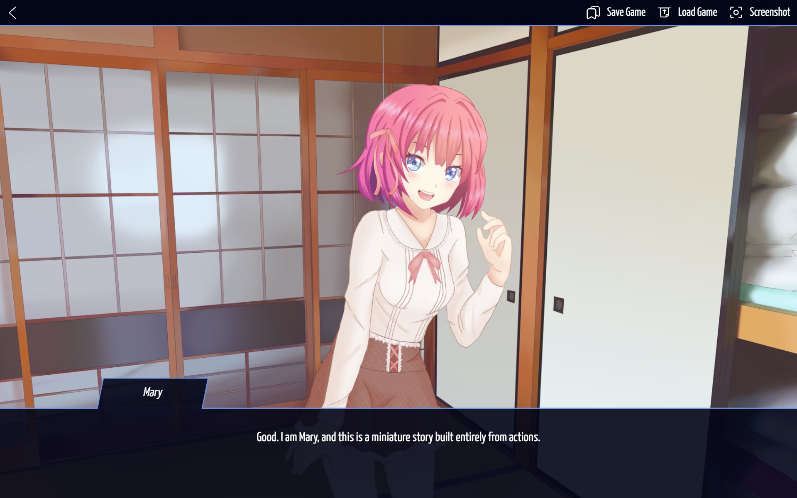
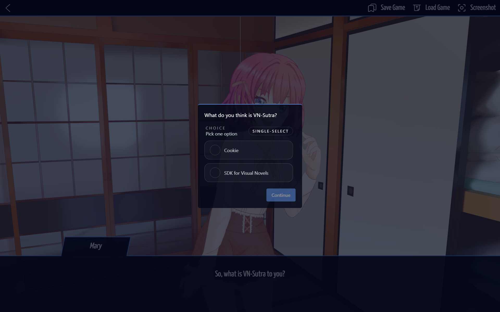

<!-- Title & badges -->
<h1 align="center">VN-Sutra</h1>

<p align="center">
  Modular Visual Novel SDK for the Web — build interactive visual novels with JavaScript.
</p>

<p align="center">
  <a href="#quick-start"></a>
  <a href="docs/"></a>
  <a href="https://github.com/tejasnayak25/vnsutra/stargazers"></a>
  <a href="https://github.com/tejasnayak25/vnsutra/issues/new"></a>
</p>

---

## Project Overview

VN-Sutra is a modular Visual Novel SDK that helps you author and ship browser-based visual novels. It provides:

- Modular game and UI modules in `vnsutra_modules/`.
- A story scripting system, assets pipeline, and save/load utilities.
- Local development tooling (dev server, Tailwind CSS watch, hot reload).

This repository includes an Express-based `api/` server used for local development and packaging, plus build scripts for production bundles.

## VS Code Extension

For editor support while working on `.vn` story files, use the companion VS Code extension: [VN-Sutra Language Tools](https://marketplace.visualstudio.com/items?itemName=tejasnayak25.vnsutra-language-tools).

It is built specifically for `.vn` files and provides:

- Syntax highlighting for scene headers, shorthand commands, dialogue, variables, and `@` actions.
- Autocomplete for scene names, actor names, variables, assets, choice options, and common `@action` keys.
- Lint diagnostics for scene placement, flow-control alignment, indentation rules, choice nesting, and unknown lines.
- Starter snippets for common VN-Sutra patterns such as scene headers, `if/else` blocks, choice blocks, and generic `@` actions.
- Command: `VN-Sutra: Create New VN Project` to bootstrap a fresh project from the latest VN-Sutra source release.
- Command: `VN-Sutra: Run Project Setup` to run `npm install` and `npm run dev` in a single terminal.
- Commands: `VN-Sutra: Run npm Script` and `VN-Sutra: Refresh npm Script Commands` for dynamic script execution from `package.json`.
- Dedicated `.vn` file icon contribution for clearer story-file visibility in the explorer.

---

## Quick Start

### 1. Create a New Visual Novel Project
Scaffold a fresh visual novel project in seconds using `npm create` or `npx`:

```bash
npm create vnsutra my-visual-novel
```
*(Or `npx vnsutra create my-visual-novel`)*

Then enter the project and start the live dev server:

```bash
cd my-visual-novel
npm install
npm run dev
```

### 2. Developing in this Repository
If you cloned the source repository directly:

```bash
npm install
npm run dev
```

What this runs (concurrently):

- `dev:server` — Express dev server with `nodemon` (api/dev.js)
- `dev:css` — Tailwind CSS watch that compiles `css/input.css` → `css/output.css`
- `dev:reload` — simple reload server (`dev-server.js`) used by the UI
- `story:watch` — watches story files and rebuilds during editing

Open http://localhost:3000 (or the port printed by `api/dev.js`).

---

## Setup

Prerequisites:

- Node.js 20.x (per `engines` in `package.json`)
- npm 8+ (or yarn/pnpm)

Install dependencies:

```bash
npm install
```

Build production CSS once (optional):

```bash
npm run build:css
```

---

## Development

Local development commands (high-level):

- `npm run dev` — Start all dev helpers (server, CSS watch, reload, story watch).
- `npm run dev:server` — Start only the Express dev server (`api/dev.js`) with `nodemon`.
- `npm run dev:css` — Tailwind CSS watch mode.
- `npm run dev:reload` — Start the reload helper `dev-server.js`.

Build commands:

- `npm run build` — Full build: story build, UI build, then `scripts/build.js`.
- `npm run build:bundle` — Build + webpack production bundle + bundle script.
- `npm run build:css` — Compile and minify CSS for production.

---

## 2.5D Parallax Stages & Live Backgrounds (`.vnstage`)

VN-Sutra features an automated computer-vision pipeline that decomposes standard 2D visual novel backgrounds into hardware-accelerated 2.5D multi-plane parallax stages packaged as compact, standalone `.vnstage` binary bundles.

Each `.vnstage` bundle encodes:
1. **Semantic Scene Structure:** SegFormer (ADE20K) separates distant sky underlays, unbroken focal base scenery, and near-camera foreground overlays with push-pull background inpainting behind occluders (zero ghost duplicates or texture holes).
2. **Continuous Metric Depth:** Depth-Anything-V2 estimates relative spatial depth for mouse tilt tracking and focal camera zooming.
3. **Single Binary Container:** Packed WebP texture atlas with embedded metadata (`[4B "VNST" | u16 version=1 | u16 flags=0 | u32 jsonLen | UTF-8 manifest JSON | raw WebP atlas]`) loaded in a single network request.

### 1. Download Model Weights
Pre-download and verify the SegFormer and Depth-Anything vision models:
```bash
npm run models:download:stages
```
*(Or run `npm run models:download` to fetch both stage and character models).*

### 2. Generate `.vnstage` Backgrounds
Process all 2D background artworks into production `.vnstage` bundles:
```bash
npm run assets:stages
```
To process an individual image:
```bash
python scripts/build-stage-atlas.py assets/game-assets/backgrounds/my_scene.png
```
Generated `.vnstage` files are saved directly under `assets/game-assets/backgrounds/`.

### 3. Interactive Preview Studio
To inspect mouse parallax tilt, depth layers, camera panning, and character layering live in the browser:
```bash
npm run assets:backgrounds
```
This builds and serves `dist/stage-parallax-preview/preview.html`.

### 4. Using Stages in Story Scripts (`.vn`)
Load a parallax stage in story files with dynamic mouse tilt or depth zoom:
```vn
# Load a stage with interactive mouse tilt:
@stage reset=true asset="cherry_park" options={"mouseTilt":true}

# Smooth crossfade between parallax stages:
transition: crossfade 800
@stage asset="apartment_stage" options={"mouseTilt":true} duration=0.8
```

In JavaScript asset definitions (`game/assets.js`):
```js
import { ParallaxStage } from "../vnsutra_modules/assets/index.js";

const cherry_park = new ParallaxStage({
    id: "cherry_park",
    url: "backgrounds/cherry_park.vnstage"
});
```

---

## Live Rigged Characters (`.vnsprite`)

VN-Sutra packages multi-mood 2D anime character sprites into `.vnsprite` bundles with GPU mesh deformation, secondary spring physics (hair and skirt sway), voice audio lip-sync, and quintic mood crossfades.

### 1. Download Character Model Weights
```bash
npm run models:download:rig
```
Downloads DWPose 133 Keypoint Estimator, SegFormer Clothes Parser, and SlimSAM-77 ONNX models into `dist/.cache/`.

### 2. Rig and Build `.vnsprite` Bundles
```bash
npm run assets:rig
```
To build or repack a specific character:
```bash
python -u scripts/rig-characters.py sakura --install
```

See [docs/RIGGED_CHARACTERS.md](docs/RIGGED_CHARACTERS.md) and [docs/PARALLAX_STAGES.md](docs/PARALLAX_STAGES.md) for full architecture and API documentation.

Notes:

- The dev server serves `api/` routes and static assets; see [api/index.js](api/index.js) and [api/dev.js](api/dev.js).
- The UI build pipeline is in `scripts/ui-build.js` and `webpack.config.cjs`.

---

## Tests & Linting

- Run tests: `npm test`
- Run tests with coverage: `npm run test:coverage`
- Lint: `npm run lint` — autofix with `npm run lint:fix`
- Format: `npm run format`

The repository uses Jest for unit and integration tests; many tests live in `tests/`.

---

## Contributing

Contributions are welcome. Recommended workflow:

1. Fork the repo and create a topic branch.
2. Run `npm install` and `npm run dev` to verify dev experience.
3. Add tests where applicable and run `npm test`.
4. Open a pull request describing the change.

Please follow the coding conventions (ES modules, JSDoc for public APIs). Pre-commit hooks are enabled via `husky` and `lint-staged`.

---

## Files of Interest

- `api/` — Express server and development entry points
- `vnsutra_modules/` — Core SDK modules used by games
- `scripts/` — Build scripts (`story-build.js`, `ui-build.js`, `build.js`)
- `css/input.css` → `css/output.css` — Tailwind input/output

---

# Screenshots

Here are some screenshots of the vnsutra demo game:

<div align="center" style="overflow-x:auto; white-space:nowrap;">
  
  
  
  
  
  
  
  
  
</div>


## License

This project is licensed under the MIT License. See the `LICENSE` file for details.
